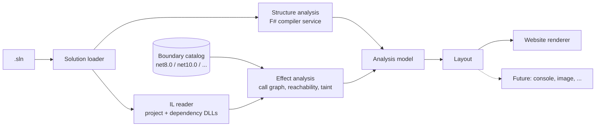

# Implementation plan: Floorplan

Floorplan is a code visualizer for .NET solutions, F# first. The name follows the metaphor: rooms are the modules, the openings between rooms are the dependencies, and the doors to the outside are the entry and exit points. The command is `floorplan`. The NuGet package ID `Floorplan` was free when checked on 2026-11-15.

Status: draft for review, 2026-11-15.

## 1. Summary

Floorplan is a CLI tool that analyzes a whole solution (`.sln` or `.slnx`) of F# projects and produces a static website showing:

1. **Module graph**: which modules depend on which other modules.
2. **Entry points**: inbound HTTP routes and the module that handles each one.
3. **Exit points**: outbound HTTP calls, database calls, file access and all other side-effects, and the module each belongs to.

The tool knows nothing about Giraffe, Falco, Saturn or any other framework. It knows only the .NET base libraries. It finds entry and exit points by following code, through any framework in between, down to the .NET primitives that actually touch the network, disk or database.

Three design decisions carry the plan:

| Decision | Choice | Why |
|---|---|---|
| How to see through frameworks | Analyze compiled IL of the project **and** its dependencies as one call graph | Frameworks ship as DLLs without source; IL is the only representation common to user code and frameworks |
| How to know what a side-effect is | A versioned, data-driven **boundary catalog** of .NET primitives, one per .NET version | New .NET versions become a data update, not a code change |
| How to support more outputs later | All analysis produces one **analysis model**; renderers only read it | Website today; console, image or anything else later without touching analysis |

## 2. Scope

**In scope**

- A whole solution as the unit of analysis. Every project in it is user code; everything else is a dependency. A single `.fsproj` is also accepted and treated as a one-project solution plus its project references.
- F# projects targeting .NET 8 and .NET 10. Projects in one solution may target different versions.
- Test projects (`IsTestProject=true`) are excluded by default, since their file and network access would show up as exit points of the application.
- Website output: plain HTML, CSS and JavaScript, no libraries, works offline from `file://`.

**Out of scope (for now)**

- Full C# support. It is a planned future phase (section 10, Phase 7) and the design must not block it (section 3.5). Until then, a C# project in the solution appears as a single node in the graph, effects found in it are attributed to the project as a whole, and the output marks it as having limited support.
- Target frameworks older than .NET 8.
- Output formats other than the website. The architecture allows them; none is built.
- Running the application. All analysis is static.
- Soundness under reflection, `dynamic`, or runtime code generation. These are reported as blind spots, not analyzed.

## 3. Architecture



### 3.1 Two sources of truth, one for each job

| Job | Source | Reason |
|---|---|---|
| Module names, nesting, source ranges, module-to-module dependencies | F# compiler service (FSharp.Compiler.Service, "FCS") | Faithful to what the developer wrote: sees inline functions, type abbreviations, literals and `open` declarations that vanish in IL |
| Entry points, exit points, call paths | IL of the built assemblies plus PDBs | Uniform across user code and frameworks; no source needed for dependencies |

The two are joined by source location: PDB sequence points map every IL method (including compiler-generated closures such as `handler@42-1`) to a file and line, and FCS maps file and line to a module.

**Alternative rejected:** using the FCS typed tree for user code and IL only for dependencies. It requires bridging two different representations at every call that crosses the boundary, which is exactly where the interesting analysis happens.

**Consequence:** the solution must build. The tool runs `dotnet build` on it in Debug configuration by default, because Debug builds inline less and have complete PDBs.

### 3.2 Solution-level rules

- **User code boundary.** An assembly is user code if it is the output of a project in the solution. All other assemblies are dependencies. This replaces any per-project notion of "mine versus theirs".
- **One call graph.** All user assemblies and their dependencies form a single call graph, so an effect in a shared library project is traced back to the endpoint in the web project that triggers it.
- **Applications.** Each executable project (`OutputType=Exe`, or a web SDK project) is an *application*. Entry points belong to an application. A solution with an API and a background worker shows two applications, each with its own entry points and reachable exit points.
- **Module identity.** A module is identified by project plus full name. Two projects may contain a module with the same name.
- **Two graph levels.** The website shows a project graph (from project references) and, inside it, the module graph. Modules are grouped by project; edges that cross projects are drawn differently from edges within one.
- **Mixed target frameworks.** The catalog is chosen per assembly from the target framework of the project that produced it. A library project that multi-targets is analyzed once, in the target framework the consuming application actually resolves.
- **Dependency versions.** If two applications resolve different versions of the same NuGet package, each is summarized separately; the summary cache is keyed by assembly identity, so this needs no special handling.

### 3.3 Pipeline stages

1. **Solution loader.** Reads the solution, evaluates every project through MSBuild (Ionide.ProjInfo), builds the solution, and returns per project: source files in compile order, project references, resolved reference DLL paths, output DLL and PDB, target framework, output type, test-project flag.
2. **Structure analysis.** Type-checks each F# project with FCS, in project-reference order, and walks all symbol uses. Each use yields an edge from the enclosing module to the declaring module. Output: module tree and weighted dependency edges with source locations, including edges across projects.
3. **IL reader.** Reads every project's output DLL and every non-framework dependency DLL with Mono.Cecil, behind a small `IAssemblyReader` interface so the library can be swapped. Target assemblies are read as metadata only and never loaded for execution.
4. **Effect analysis.** Builds the call graph, matches calls against the boundary catalog, and computes entry points, exit points and evidence paths (sections 5 and 6).
5. **Analysis model.** One immutable, serializable document with a `schemaVersion` (section 7).
6. **Layout.** Computes graph coordinates once, in the core, so every renderer draws the same picture.
7. **Renderer.** Writes the website.

### 3.4 Repository structure

```
src/
  Floorplan.Model/            Records for the analysis model, JSON schema
  Floorplan.ProjectLoading/   Solution parsing, MSBuild evaluation, build, TFM detection
  Floorplan.Structure/        IStructureAnalyzer and shared types
  Floorplan.Structure.FSharp/ FCS-based module graph
  Floorplan.IL/               Assembly reading, call graph
  Floorplan.IL.Codegen.FSharp/ Recognizers for F# compiler output
  Floorplan.Catalog/          Catalog format, loading, matching; catalogs/*.json
  Floorplan.Analysis/         Reachability, taint, route inference, attribution
  Floorplan.Layout/           Graph layout
  Floorplan.Rendering/        IRenderer + website renderer (site assets embedded)
  Floorplan.Cli/              Argument parsing, orchestration; packaged as a dotnet tool
tools/
  CatalogDiff/            Catalog maintenance tool (section 8.3)
tests/
  fixtures/               Small apps, one per routing/effect style, per TFM
  Floorplan.Tests/            Unit tests and golden-file tests
```

### 3.5 Designing for C# now

C# support is not built in the first release, but these rules apply from Phase 1 so that adding it later is an addition and not a rewrite. Most of the pipeline is already language-neutral because it works on IL; the rules below cover the parts that are not.

| Rule | What it means in practice |
|---|---|
| Structure analysis sits behind an interface | `IStructureAnalyzer` takes a loaded project and returns units and dependency edges. The F# implementation uses FCS. A C# implementation using Roslyn is added later. The solution loader picks the analyzer by project language |
| The model speaks of *units*, not modules | A unit has a `kind`: `module` today; `namespace` and `type` later. Nothing downstream of structure analysis may assume a unit is an F# module |
| Compiler-output recognizers are per language | How closures, state machines and pattern matches look in IL differs between the F# and C# compilers. Recognizers live in `Floorplan.IL.Codegen.FSharp` behind a common interface and are selected per assembly. The taint and call-graph engines only see the recognizers' neutral output (for example "this value is compared to this constant") |
| Layout handles cycles | F# graphs are acyclic; C# graphs are not. The layout always collapses strongly connected groups first and never assumes acyclicity, even though F# rarely needs it |
| The website takes its labels from the model | Headings and labels use the unit kind. "Module" is not hard-coded in the site |
| Source-to-IL joining is language-neutral | Joining by PDB sequence points works the same for both languages and must not use F#-specific naming conventions |
| No F#-only assumptions in the CLI or model | The solution loader records each project's language from day one, and projects in an unsupported language are carried through the model with a `supportLevel` |

A CI test enforces the main rule: `Floorplan.Analysis`, `Floorplan.Layout` and `Floorplan.Rendering` must not reference FCS or any `*.FSharp` project.

## 4. The boundary catalog

The catalog is the tool's entire knowledge of what counts as "outside the application". It is data, not code.

### 4.1 What an entry looks like

```json
{
  "id": "http-out.httpclient",
  "assembly": "System.Net.Http",
  "type": "System.Net.Http.HttpMessageInvoker",
  "members": ["Send", "SendAsync"],
  "includeDerivedTypes": true,
  "kind": "sink",
  "category": "http-out",
  "payload": [{ "argument": 0, "role": "request" }]
}
```

- `kind` is `sink` (an effect happens here), `source` (external data enters here) or `registration` (a handler is registered here).
- `includeDerivedTypes` makes the rule apply to overrides and implementations. One rule on `System.Data.Common.DbCommand.Execute*` therefore covers SqlClient, Npgsql and every other ADO.NET provider without naming any of them.
- `payload` says which argument carries the URL, SQL text or file path, so the tool can try to show it. When the
  value is a property of the receiver rather than an argument, the entry names it: `{ "property": "CommandText",
  "constructorArgument": 0, "role": "sql" }` takes the value last stored through `set_CommandText` on the same
  object before the call, or else the constructor's string argument 0 (`new SqlCommand(sql, connection)`).

### 4.2 Categories

| Category | Direction | Example primitives |
|---|---|---|
| `http-in` | entry | `HttpRequest.Path`/`.Method`, `RequestDelegate`, endpoint route builders, `HttpListener` |
| `http-out` | exit | `HttpMessageInvoker.Send*`, `HttpClient.*Async` |
| `network` | both | `Socket`, `TcpListener`, `Dns` |
| `database` | exit | `DbCommand.Execute*`, `DbConnection.Open*` |
| `filesystem-read` / `filesystem-write` | exit | `File.*`, `FileStream`, `Directory.*` |
| `process` | exit | `Process.Start` |
| `native` | exit | Any P/Invoke declared outside the base libraries |
| `environment` | exit | Environment variables, `Console` |
| `nondeterminism` | exit | Clock, random numbers |

`environment` and `nondeterminism` are hidden by default in the website. Nearly every library touches them and they would bury the useful results.

The catalog covers two shared frameworks: `Microsoft.NETCore.App` (base libraries) and `Microsoft.AspNetCore.App` (Kestrel, routing, `HttpContext`). ASP.NET Core is a shared framework that ships and versions with .NET, so it counts as a primitive layer, not a third-party framework.

### 4.3 Where the analysis stops

The analysis follows calls through user code and NuGet dependencies and stops at the first call into a shared-framework assembly. If that call matches a catalog rule it is an effect. If not, it is assumed pure. The base libraries themselves are not analyzed at run time.

This is the main trade-off in the plan. Analyzing the base libraries down to operating-system calls would need no catalog, but it loses meaning (a SQL query and an HTTP call both end as socket writes) and virtual dispatch inside the base libraries makes almost everything appear to reach everything. The plan uses that deeper analysis only as a maintenance aid (section 8.3).

### 4.4 Versioning

```
catalogs/
  net8.0.json      full catalog
  net10.0.json     { "extends": "net8.0", "add": [...], "remove": [...] }
```

Each later catalog is a delta on the previous one. Users can pass `--catalog extra.json` to add their own rules, for example for an in-house library that should be treated as a boundary.

## 5. Finding exit points

1. **Build the call graph** over user assemblies and dependency assemblies.
   - Direct calls: read from IL.
   - Virtual and interface calls: resolved with rapid type analysis, meaning only types that are actually instantiated somewhere are candidates.
   - F# closures: each lambda compiles to a class deriving from `FSharpFunc`. The construction site links the closure to its `Invoke` body.
   - Async, task and other state machines: the generated `MoveNext` method is linked back to the method that starts it.
2. **Summarize dependencies.** For each method in a dependency DLL, compute which catalog categories it can reach. Summaries are cached on disk per assembly identity (MVID), so a NuGet package is analyzed once per machine.
3. **Find boundary call sites.** An exit point is a call site in user code whose target is either a catalog sink or a dependency method whose summary reaches one.
4. **Attribute.** The exit point belongs to the module containing that call site. The record keeps the dependency assembly the call went through, which gives a natural label ("network, via RabbitMQ.Client") without the tool knowing the library.
5. **Recover payloads.** Constant propagation over the payload argument, best effort. A literal URL is shown as is; an interpolated string is shown as a template; anything else is "dynamic".
6. **Keep the evidence.** Every exit point stores the shortest call path from the user call site to the catalog primitive. The website shows it, so each result can be checked by hand.

## 6. Finding entry points

### 6.1 Principle

The tool does not recognize routing styles. It rests on one fact: for an application to receive a request, some code must call a .NET primitive that accepts inbound connections, and the request must then flow from that primitive to the code that handles it. Everything in between, whether a published framework, an in-house HTTP package or hand-written code, is ordinary code that the tool follows like any other.

An entry point is therefore defined without reference to any framework:

> User code that is reachable from an inbound-connection primitive and receives data derived from the request.

Finding entry points is three separate questions, answered by general mechanisms:

| Question | Mechanism | Depends on how routing was written? |
|---|---|---|
| Where can requests come in? | Catalog of inbound primitives (6.2) | No |
| Which user code handles them? | Call graph plus request-data tracking (6.3) | No |
| Which request reaches which handler? | Collecting the conditions on request data along the way (6.4) | Only in how much can be recovered |

The first two always produce an answer. The third produces a complete route, a partial route, or "unresolved", and says which.

### 6.2 Inbound primitives

The catalog lists every way .NET 8 and .NET 10 let a process accept inbound HTTP:

| Layer | Primitives (catalog `source` and `registration` rules) |
|---|---|
| ASP.NET Core server | `IHttpApplication.ProcessRequestAsync`, `RequestDelegate`, middleware registration (`IApplicationBuilder.Use`/`Run`), `IMiddleware` |
| ASP.NET Core request data | `HttpRequest.Method`, `.Path`, `.PathBase`, `.Host`, `.Query`, `.Headers`, `.RouteValues`, `.Body` |
| ASP.NET Core routing | Endpoint route builders, `RoutePattern`, `EndpointDataSource` |
| `System.Net.HttpListener` | `GetContext*`, `HttpListenerRequest.HttpMethod`, `.Url`, `.RawUrl`, `.Headers` |
| Upgraded connections | WebSocket accept on either stack |
| Raw network | `Socket.Accept*`, `TcpListener.Accept*`, `NetworkStream` reads |

gRPC, SignalR, MVC, Razor Pages and minimal APIs are all built on the ASP.NET Core rows, so they need no entries of their own.

### 6.3 Finding the handling code

1. **Roots.** Every call site that reaches an inbound primitive is a root. This includes roots inside dependencies: a framework that calls `HttpListener.GetContext` on the application's behalf is found the same way as user code that does.
2. **Request data.** Values read from the request primitives are tagged by kind: *method*, *path*, *host*, *query*, *header*, *body*. Tags survive every transformation the value goes through: splitting, trimming, lower-casing, wrapping in a record or a union case, storing in a field, passing through a closure.
3. **Handlers.** A handler is the first user function on a call path from a root that receives tagged data, or that is invoked on a branch chosen by tagged data. Its unit is the handling module.

This step works for any application, including ones where no route can be recovered.

### 6.4 Recovering routes

A route is the set of conditions a request must satisfy to reach a given handler. The tool collects those conditions wherever they occur, in user code or in a dependency, in whatever form they were written. There are three general forms.

**A. Conditions in control flow.** Somewhere between root and handler, tagged data is compared with constants and the result decides which code runs. The tool records each comparison as a predicate on the request:

| Operation on tagged data | Predicate recorded |
|---|---|
| Equality with a constant (`=`, `String.Equals`, `switch`, pattern match) | *path = "/api/path"*, *method = "GET"* |
| `StartsWith`, `EndsWith`, `Contains`, `PathString.StartsWithSegments` | *path starts with "/api"* |
| `Split` followed by element or list access compared with constants | *segment 0 = "api"*, *segment count = 2* |
| `Substring`, span slicing, `IndexOf` | Positional predicates, when offsets are constant |
| `Regex` with a constant pattern | *path matches `^/orders/\d+$`* |
| Element or list access not compared with anything | A route parameter: *segment 2 = {param}* |

The predicates that hold on the path to a handler are combined. The rows are operations of the .NET base library and of the compilers (how a pattern match or `switch` is emitted), never shapes of a particular framework. Supporting a new routing style needs no new code as long as it is built from these operations.

**B. Lookup in a table.** The handler is stored in a data structure together with constants, and at request time the structure is consulted with tagged data. Examples: a dictionary from path to handler, a list of *(method, template, handler)* tuples that is searched, a trie built at start-up. The tool tracks function values into collections alongside the constants stored with them, and treats a lookup keyed by tagged data as selecting among those entries. The constants become the route.

**C. .NET's own routing.** The route template and handler are handed to ASP.NET Core routing. This is form B where the table is the platform's, and the catalog already knows which argument is the template and which is the handler. It is the cheapest case and the most reliable.

Most real applications combine these. A framework may take templates in a table (B), match them with its own string code (A), and mount the whole thing as one ASP.NET Core middleware under a path prefix (A again). The predicates simply accumulate along the path.

### 6.5 One illustration

The example below is one of many possible ways to write routing. It is used here only to show the mechanism at work, and nothing in the tool is specific to it.

```fsharp
match req.route with
| GET (["api"; "path"], query) -> Orders.list query
| POST (["api"; "path"], _)    -> Orders.create req
```

- `req.route` is followed into the package that defines it. Its value is built from a method primitive and from a path primitive split on `/`, so it carries *method* and *path segments* tags.
- `GET` is an active pattern in that package. Its body compares the *method* part with the constant `"GET"`: predicate *method = "GET"*.
- The list pattern is emitted as element accesses and string comparisons: *segment 0 = "api"*, *segment 1 = "path"*, *segment count = 2*.
- Combined: `GET /api/path`, handled by the first user function called on that branch, `Orders.list`, in module `Orders`.

The same mechanism covers `if path.StartsWith "/api" then ...`, a `Dictionary<string, Handler>` lookup, a chain of combinators that each test one segment, or a C#-style `switch` on a tuple of method and path.

### 6.6 What is reported

Each entry point carries the predicates that were recovered and a completeness level:

| Level | Meaning | Shown as |
|---|---|---|
| **Complete** | Method and full path are determined | `GET /api/orders/{param}` |
| **Partial** | Some predicates recovered, others not | `GET /api/*`, with the predicates listed |
| **Unresolved** | The handler is known but no usable predicate was recovered | Handler and source location only |

Predicates that do not fit a path template (host, header or query conditions, regular expressions) are listed as they are. The tool never guesses and never fills gaps.

Each entry point also records which forms (A, B, C) contributed, and the evidence: every comparison with its source location or, inside a dependency, its assembly and method.

### 6.7 Limits

Recovering routes from arbitrary code cannot be complete; in general it is undecidable. Coverage is defined by the set of operations in 6.4, and anything outside it degrades to partial or unresolved, visibly. Known cases:

- Routes read from configuration, a database or reflection over attributes at run time.
- Regular expressions or templates assembled at run time.
- Hand-written HTTP parsing on raw sockets: the handler is found, but the method and path are produced by byte-level parsing the tool does not model. These are reported as network entry points, unresolved.
- Custom template syntaxes: a table entry such as `"/orders/:id"` is reported as the literal string. The tool does not know that `:id` is a parameter unless the matching code is built from the operations in 6.4.

Compiler-specific knowledge (how the F# compiler emits pattern matches, list access, closures and active patterns) lives in one place, `Floorplan.IL.Codegen.FSharp`, with tests per compiler version. Compiler output can change between F# releases and this isolates the impact. It is also where a C# counterpart plugs in later (section 3.5).

### 6.8 Entry-to-exit traces

With both ends known, call-graph reachability from each entry point's handler gives the set of side-effects that endpoint can cause. This is the most useful view for security and impact questions ("which endpoints can write to the database?").

## 7. Analysis model and output

### 7.1 Analysis model

```
AnalysisModel
  schemaVersion, toolVersion, generatedAt
  solution       name, path
  projects[]     id, name, language, supportLevel, targetFramework, isApplication,
                 catalogUsed, catalogFallback?, projectReferences[]
  units[]        id, projectId, kind, name, parent, file, range
  dependencies[] fromUnit, toUnit, weight, crossProject, sampleLocations[]
  entryPoints[]  applicationId, handlerUnit, location, predicates[], route?, completeness, forms[], evidence
  exitPoints[]   category, unit, location, payload?, viaAssembly?, evidence
  traces[]       entryPointId -> exitPointIds[]
  layout         node positions, edge routes
  diagnostics[]  blind spots, unresolved items, warnings
```

A unit is the node of the graph. In the first release its `kind` is always `module`. The rest of this document says "module" where it describes F# behaviour.

Rules that keep future renderers cheap:

- Renderers receive the model and nothing else. No renderer calls into analysis.
- Layout is in the model. A future SVG or PNG renderer draws the same coordinates as the website.
- `floorplan analyze --format json` writes the model itself. This costs nothing and makes the tool scriptable from day one.

```fsharp
type IRenderer =
    abstract Name: string
    abstract Render: model: AnalysisModel * output: OutputTarget -> Result<unit, RenderError>
```

### 7.2 Website

Files written:

```
floorplan-out/
  index.html
  app.css
  app.js
  data.js        // window.FLOORPLAN_DATA = { ...analysis model... }
```

The model is emitted as a script, not as a `.json` file, because browsers block `fetch` of local files and the site must open by double-click. `--single-file` inlines everything into one HTML file for sharing.

Views:

| View | Content |
|---|---|
| Overview | Projects, applications, counts, target frameworks, catalogs used, warnings |
| Project graph | Projects and their references; click a project to open its modules |
| Module graph | SVG drawn from precomputed layout, modules grouped by project; pan, zoom, collapse a project to one node, click a module to highlight its dependencies and dependents |
| Entry points | Table: application, route or predicates, handling module, completeness (complete, partial, unresolved); filter and search |
| Exit points | Table: category, project, module, payload, via; filter by category |
| Module detail | Depends on, used by, its entry points, its exit points |
| Evidence | The call path or guards behind any single result |
| Diagnostics | Unresolved entry points, blind spots, catalog fallback notice |

Constraints: no JavaScript or CSS libraries, no build step for the site, no network requests, keyboard navigable, light and dark themes.

Layout: F# enforces file order and project references cannot be circular, so module dependencies form a directed acyclic graph, except inside `rec` groups. A layered layout (rank by longest path, order by barycenter) is simple to implement and reads top-down in dependency order. Recursive groups are collapsed into one node first. Layout runs in two passes: projects first, then modules inside each project's box. Large solutions open with projects collapsed.

### 7.3 CLI

```
floorplan analyze [<path/to/App.sln>]    default: the solution in the current directory
      [-o|--output <dir>]            default ./floorplan-out
      [--include <project,...>]      analyze only these projects and what they reference
      [--exclude <project,...>]
      [--include-tests]              test projects are excluded by default
      [-f|--framework <tfm>]         preferred target framework for multi-targeting applications
      [-c|--configuration <name>]    default Debug
      [--format site|json]           default site
      [--single-file]
      [--catalog <file>]             additional catalog rules
      [--show <category,...>]        include categories hidden by default
      [--no-build]
```

## 8. .NET version strategy

.NET ships one major version per year in November; even-numbered versions are long-term support. The tool must handle versions that do not exist yet.

### 8.1 What depends on the .NET version

| Component | Depends on version? | How it is handled |
|---|---|---|
| Reading assemblies | No. The metadata format is stable, and target assemblies are never loaded | Nothing to do |
| Boundary catalog | Yes | New delta file per version |
| F# compiler service | Yes: must understand the project's F# language version | Package bump |
| MSBuild evaluation | Yes: uses the installed SDK | Tool rolls forward to the newest installed runtime (`RollForward=LatestMajor`) |
| F# codegen idioms | Sometimes | Isolated module, tests per compiler version |
| Analysis, model, renderers | No | Nothing to do |

### 8.2 Unknown versions

If any project targets a version with no catalog (say `net14.0` when the newest catalog is `net12.0`), the tool uses the newest catalog it has, completes the analysis, and shows a prominent notice in the output: results may miss primitives added since. It does not fail.

### 8.3 Yearly update procedure

1. Bump FSharp.Compiler.Service and Ionide.ProjInfo.
2. Run `tools/CatalogDiff` against the new version's reference packs. It lists public API added or removed in the watched namespaces (`System.Net.*`, `System.IO.*`, `System.Data.*`, `System.Diagnostics`, `Microsoft.AspNetCore.Http.*`, `Microsoft.AspNetCore.Routing.*`).
3. Review the list and write the delta catalog. Expected size: a handful of entries.
4. Add the new target framework to the fixture matrix in CI. Fix any codegen-idiom tests that fail.
5. Release.

Later improvement to step 2: analyze the new base-library implementation down to its operating-system calls and list every public method that reaches one but matches no catalog rule. This turns "did we miss something?" from review into a computed answer.

## 9. Testing

- **Fixture apps**, each built for `net8.0` and `net10.0`:
  - Entry points, organized as a matrix and not by framework. Each fixture is a few lines of hand-written routing:
    - Inbound primitive: ASP.NET Core middleware, ASP.NET Core endpoint routing, `HttpListener`, raw socket
    - Route form: control flow, table lookup, platform routing, and combinations
    - Operation: equality, `StartsWith`, split and index, list pattern, active pattern, `switch`, constant regex, dictionary lookup
    - Location of the routing code: in user code, and the same code moved into a separate library project that is treated as a dependency
  - Real frameworks as a second layer of fixtures, to confirm that what works on the matrix works in the wild. They are test inputs only
  - Negative cases: routes from configuration and run-time-built regexes must come out as partial or unresolved, never as a wrong route
  - Effects: `HttpClient`, ADO.NET via two different providers, file read and write, process start, each called directly and through a wrapper library
  - Higher-order code: effects behind injected functions, interfaces, `async` and `task`
- **Fixture solutions**:
  - Web project plus two library projects, with the effect in a library and the route in the web project
  - Two applications sharing one library
  - Mixed target frameworks: a `net8.0` library used by a `net10.0` application
  - Same module name in two projects
  - A test project that must be excluded by default
  - An F# application calling a C# library that performs an effect: the effect must be found, attributed to the C# project node, and marked as limited support
- **Golden files**: the analysis model for each fixture is checked in; any change shows up as a diff in review.
- **Framework neutrality check**: a CI test fails if any framework name appears in `src/`. Frameworks exist only under `tests/fixtures/`.
- **Website**: a small set of browser smoke tests against a fixture's output.

## 10. Phases

Sizes are rough estimates for one developer and should be revised after Phase 0.

| Phase | Deliverable | Done when | Size |
|---|---|---|---|
| 0. Spike | Throwaway code answering the three riskiest questions (section 11, risks 1 to 3) | Go/no-go on the route-recovery approach (section 6.4, form A) and call-graph scale, written down | 1–2 weeks |
| 1. Module graph | Solution loader, FCS structure analysis, model, two-level layout, website shell with project graph, module graph and module detail | Running `floorplan analyze` on a real multi-project solution gives a usable graph on net8.0 and net10.0 | 4–5 weeks |
| 2. Exit points | IL reader, call graph, catalog for net8.0 and net10.0, direct and transitive sinks, evidence paths, exit-point view | All effect fixtures pass; results on a real project are reviewed by hand | 4–6 weeks |
| 3. Entry points: handlers and platform routing | Inbound catalog, roots, request-data tagging, handler discovery (6.2, 6.3), form C, entry-point view | Every entry-point fixture reports the correct handlers; platform-routing fixtures report complete routes; all others report unresolved | 3–4 weeks |
| 4. Entry points: route recovery | Predicate collection for forms A and B, route assembly, completeness levels | The fixture matrix passes; negative cases produce no wrong routes | 5–7 weeks |
| 5. Traces and noise control | Entry-to-exit traces, category filters, summary cache, performance work | Analysis of a mid-size service finishes in acceptable time with a warm cache | 2–3 weeks |
| 6. Release | dotnet tool packaging, `CatalogDiff`, documentation, CI matrix | Installable with `dotnet tool install`; update procedure tested by writing a draft catalog for the next .NET version | 2 weeks |

| *Future* 7. C# support | Roslyn-based `IStructureAnalyzer` with types grouped by namespace as units; `Floorplan.IL.Codegen.CSharp` recognizers for lambdas, async state machines and `switch` patterns; cycle-aware graph presentation; C# fixtures | C# and mixed solutions pass the same fixture categories as F#; no change needed in analysis, layout or rendering code | 4–6 weeks |

Phase 7 is not part of the current scope. It is listed so that the design rules in section 3.5 have a concrete target. Its "done when" doubles as the test of whether those rules were followed.

Phases 1 and 2 are independently useful. Phase 4 is the hardest and the least certain. It can ship incrementally, one operation or form at a time, because Phase 3 already reports every handler and anything not yet recoverable shows as partial or unresolved instead of being hidden.

## 11. Risks

| # | Risk | Impact | Mitigation |
|---|---|---|---|
| 1 | Route conditions cannot be recovered reliably from compiled code | Many routes come out partial or unresolved | Phase 0 tests three differently written routers, not one. Handlers are always reported regardless. Fallback for user code: read conditions from the F# syntax tree and use IL only for dependencies |
| 2 | Call graph over-approximates: virtual dispatch and first-class functions make everything reach everything | Results are noise | Rapid type analysis, closure tracking, no resolution of `System.Object` virtuals, confidence levels, evidence paths so false positives are visible |
| 3 | Analysis is too slow on real dependency trees | Tool is unpleasant to use | Per-assembly summary cache; analyze only methods reachable from user code |
| 4 | Effects behind dependency injection or interfaces are attributed to the implementation, not the caller | Surprising attribution | Record both the interface call site and the implementation; show both in the trace |
| 5 | Catalog gaps: an effect primitive is not listed | Silent misses | `CatalogDiff`, user-supplied catalogs, later the computed gap check in section 8.3 |
| 6 | F# compiler changes how constructs are emitted | Codegen recognizers break | Isolated module, tests per compiler version in the CI matrix |
| 7 | Reflection, runtime code generation, plug-in loading | Silent misses | Detect use of these APIs and list them under Diagnostics as blind spots |
| 8 | Release builds differ from the analyzed Debug build | Minor differences in attribution | Documented; `--configuration` lets users compare |
| 9 | Large solutions: slow type-checking and an unreadable graph | Tool is unusable where it matters most | `--include`/`--exclude`, projects collapsed by default, per-project FCS results cached between runs |
| 10 | One project in the solution fails to build or load | No output at all | Analyze the projects that did build, list the failures under Diagnostics, exit with a non-zero code |
| 11 | F#-specific assumptions leak into shared code before C# support is built | Phase 7 becomes a rewrite | Design rules in section 3.5, the CI reference check, and the mixed-language fixture from Phase 2 onwards |

## 12. Open decisions

1. **C# unit granularity**: decided 2026-11-17, one unit per namespace ([status](docs/csharp-support.md)).
2. **Mono.Cecil or System.Reflection.Metadata** for IL reading. The plan assumes Cecil for development speed, behind an interface. System.Reflection.Metadata is maintained with .NET itself and is the alternative if Cecil lags a future metadata change.
3. **Runtime cross-check** as a later optional mode: start the app with the server replaced and read the registered endpoints, to validate platform-routing results. Outside the static-only scope today.
